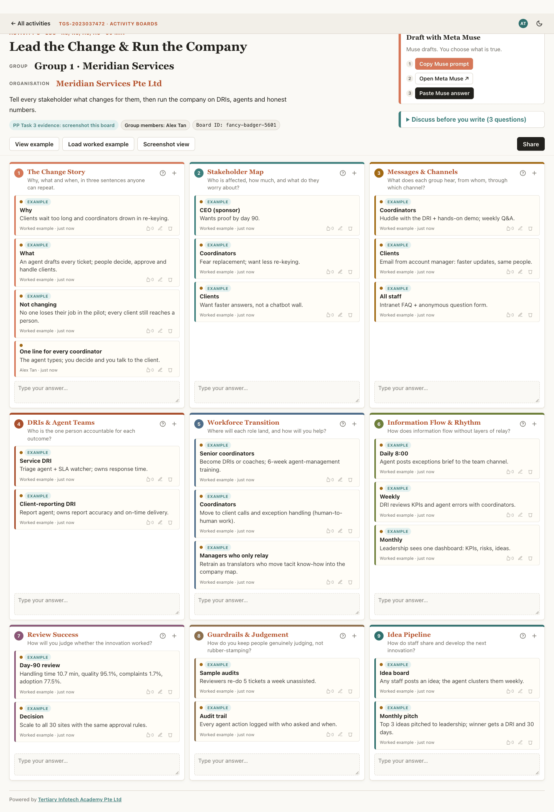
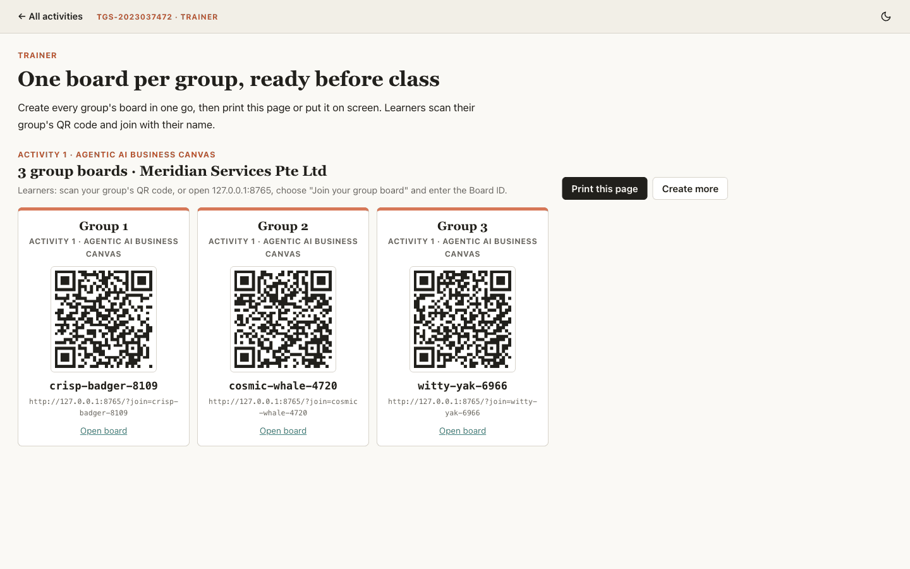

<div align="center">

# Activity Boards: Business Innovation with Agentic AI and AI Agents

[](https://developer.mozilla.org/en-US/docs/Web/HTML)
[](https://developer.mozilla.org/en-US/docs/Web/CSS)
[](https://developer.mozilla.org/en-US/docs/Web/JavaScript)
[](https://firebase.google.com/)
[](https://opensource.org/licenses/MIT)

**Build each activity with your group on one live board, screenshot it, paste it into your Practical Performance.**

[Open the boards](https://alfredang.github.io/bcm/) · [Trainer: create group boards](https://alfredang.github.io/bcm/#/trainer) · [Report a bug](https://github.com/alfredang/bcm/issues)

</div>


## What this is

The online activity tool for the WSQ course **Business Innovation with Agentic AI and AI Agents** (TGS-2023037472, Tertiary Infotech Academy). There is one board per learning outcome. Learners work in groups: each group shares one live board, joins it with just their names (no login), types its answers into each block as sticky notes, and screenshots the finished board.

> **For the PP:** discuss and build it together on your group board. For the PP, every member pastes the group board screenshot and writes their own answers.

| Activity | Board | LO · K&A | Screenshot goes into | Deep link |
|---|---|---|---|---|
| 1 | Agentic AI Business Canvas (the Business Model Canvas, re-read for agentic AI) | LO1 · K1, K2, A1, A2 | **PP Task 1** | <https://alfredang.github.io/bcm/?activity=opportunity> |
| 2 | AI Action Plan | LO2 · K3, K4, A3, A4 | **PP Task 2** | <https://alfredang.github.io/bcm/?activity=actionplan> |
| 3 | Lead the Change & Run the Company | LO3 · K5, K6, A5, A6 | **PP Task 3** | <https://alfredang.github.io/bcm/?activity=change> |

The activity content (block titles, prompts, guiding questions, discussion questions, the Meta Muse prompt and the worked example) comes from the course build in [`js/templates.js`](js/templates.js). That file is generated; do not edit it by hand.

## How a class uses it

1. **Trainer: create the group boards.** Open [`#/trainer`](https://alfredang.github.io/bcm/#/trainer), pick the activity and the number of groups (1-10), optionally name the groups, and press *Create group boards*. You get one printable page with each group's name, Board ID, join link (`?join=<id>`) and QR code. A group leader can also create a single board from the landing page (*Create a group board*: group name, organisation, their name).
2. **Learners: join your group board.** Scan your group's QR code, or enter the Board ID on the landing page, then type your name. Everyone on the board edits live.
3. **Draft with Meta Muse.** On the board, *Copy Muse prompt* copies the activity's prompt; *Open Meta Muse* opens <https://muse.ai/> in a new tab. Paste Muse's numbered reply into *Paste Muse answer*: the board matches each line to its block, shows a preview, and adds only the answers you tick (tagged `Muse`). Lines it can't match stay in the dialog for copying by hand.
4. **Type your answers.** Every block has a *Type your answer…* box: Enter saves (Shift+Enter for a new line; the first line becomes the headline). The **+** button opens the full note editor (tag, priority, status). Notes can be voted on, edited and dragged to reorder.
5. **Stuck?** *View example* shows how a fictional sample company filled in each block, without writing anything. *Load worked example* copies those notes onto the board, tagged `Example`.
6. **Hand it in.** *Screenshot view* hides the editing tools and adds a header strip with the course, activity, **group name**, the learner's own name, the organisation, the date and the PP task. From there: **Download PNG**, **Download PDF** (one landscape A4 page) or **Print**.

## Screenshots

| Activity 1 · Agentic AI Business Canvas | Activity 2 · AI Action Plan |
|---|---|
|  |  |
| **Activity 3 · Lead the Change & Run the Company** | **Screenshot view (what goes into the PP)** |
|  |  |

Trainer page after creating three group boards:



## Tech stack

| Area | Choice |
|---|---|
| Pages | Plain HTML, CSS and ES-module JavaScript. No build step. |
| Real-time data | Firebase Cloud Firestore (modular SDK from the gstatic CDN) |
| QR codes | QRCode.js (jsDelivr) |
| Screenshot export | html2canvas and jsPDF (jsDelivr, loaded only when first used); print stylesheet as fallback |
| Hosting | GitHub Pages via GitHub Actions |
| Design | Tertiary Infotech course-site look: ivory `#FAF9F5`, charcoal `#21201C`, terracotta `#D97757`, teal `#3A7D7B`, Cambria headings, Calibri body. Light by default, dark theme on request. |

## Project structure

```
bcm/
├── index.html            # Landing, trainer page, board page, modals
├── css/styles.css        # Design tokens (light + dark), layouts, screenshot + print styles
├── js/
│   ├── templates.js      # GENERATED by the course build: activities, Muse prompts, worked example
│   ├── boards.js         # Activity catalogue; classic BMC + retired activities for older boards
│   ├── app.js            # Theme, routing (#/c/<id>, #/trainer, ?activity=, ?join=), toast, modals
│   ├── landing.js        # Activity cards, join / create a group board
│   ├── trainer.js        # Bulk-create group boards, printable QR page
│   ├── canvas.js         # Board page: header, blocks, typed answers, presence
│   ├── notes.js          # Sticky notes: live sync, editor, votes, reorder, worked example
│   ├── muse.js           # Copy Muse prompt; parse a pasted Muse reply into notes
│   ├── shot.js           # Screenshot view, PNG / PDF / print
│   ├── share.js          # QR code + invite link
│   └── firebase.js       # Firebase config
├── docs/screens/         # Screenshots
└── screenshot.png        # Landing page screenshot
```

## Data model (Firestore)

```
canvases/{boardId}                    title, group, org, type, ownerName, learners[],
                                      createdVia ("trainer" for bulk-created boards), createdAt
canvases/{boardId}/blocks/{blockId}/notes/{noteId}
                                      title, description, category, priority, status,
                                      authorId, authorName, votes, voters[], order,
                                      createdAt, updatedAt
canvases/{boardId}/presence/{participantId}   name, color, lastSeen
```

- `type` is the activity key (`opportunity`, `actionplan`, `change`). `title` is the group name.
- Older boards keep working. A board with no `type` (or `bmc`) opens with the classic nine-block Business Model Canvas; a board of the retired `companymap` activity opens with its notes and a "retired activity" note. Neither can be created any more.
- `category` is free text; `Example` (worked example) and `Muse` (pasted from Meta Muse) are styled tags.

Firestore rules are set by the project owner in the Firebase console. The app expects read/write access to `canvases/**`.

## Run locally

```bash
git clone https://github.com/alfredang/bcm.git
cd bcm
python3 -m http.server 8080
```

Open <http://localhost:8080>. ES modules need an HTTP origin; `file://` will not work.

## Deploy

`.github/workflows/deploy-pages.yml` publishes the repository to GitHub Pages on every push to `main`.

## Acknowledgements

- Business Model Canvas by **Alexander Osterwalder and Yves Pigneur** (Strategyzer).
- [Firebase](https://firebase.google.com/), [QRCode.js](https://github.com/davidshimjs/qrcodejs), [html2canvas](https://html2canvas.hertzen.com/), [jsPDF](https://github.com/parallax/jsPDF).

## Developed by

**Tertiary Infotech Academy Pte Ltd**: [tertiarycourses.com.sg](https://www.tertiarycourses.com.sg/)

## License

[MIT](https://opensource.org/licenses/MIT)

---

<div align="center">Powered by <a href="https://www.tertiarycourses.com.sg/">Tertiary Infotech Academy Pte Ltd</a></div>
