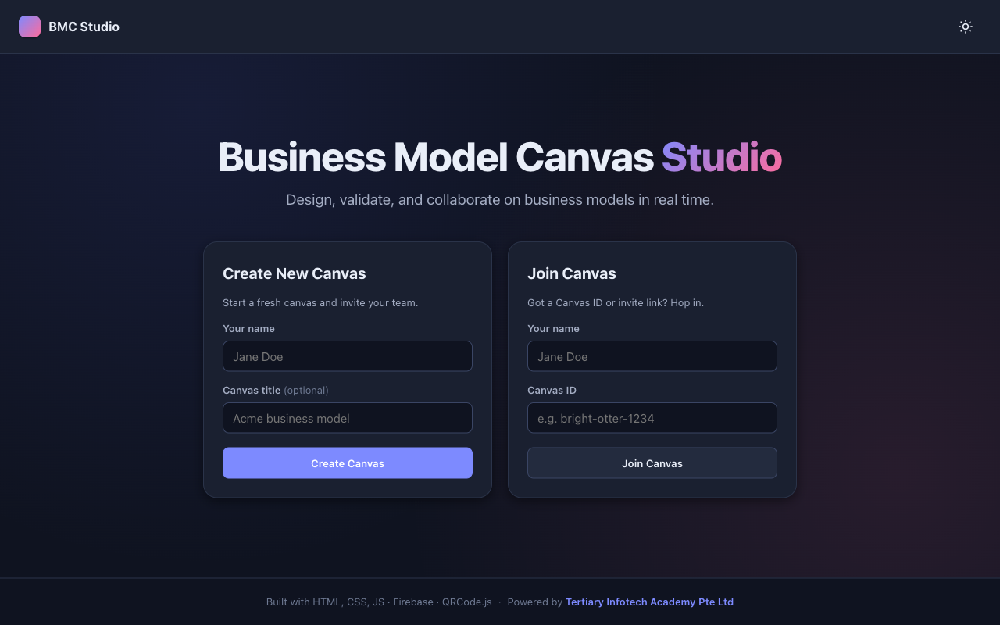

<div align="center">

# Business Model Canvas Studio

[](https://developer.mozilla.org/en-US/docs/Web/HTML)
[](https://developer.mozilla.org/en-US/docs/Web/CSS)
[](https://developer.mozilla.org/en-US/docs/Web/JavaScript)
[](https://firebase.google.com/)
[](https://github.com/davidshimjs/qrcodejs)
[](https://opensource.org/licenses/MIT)

**Design, validate, and collaborate on business models in real time.**

[Live Demo](https://alfredang.github.io/bcm/) · [Report Bug](https://github.com/alfredang/bcm/issues) · [Request Feature](https://github.com/alfredang/bcm/issues)

</div>

## Screenshot



## About

**Business Model Canvas Studio** is a modern, mobile-friendly web app that lets teams build a Business Model Canvas together in real time. Create a canvas, share a QR code or invite link, and collaborate on sticky notes across all nine BMC blocks — with live presence, voting, drag-and-drop, and instant sync.

Built entirely with **plain HTML, CSS, and JavaScript** — no React, no Vue, no build step. Real-time collaboration is powered by Firebase Firestore and invite QR codes are generated client-side with QRCode.js.

### Key Features

| Feature | Description |
|---------|-------------|
| Real-time collaboration | Sticky notes, votes, edits, and presence sync instantly across all participants via Firestore. |
| QR + invite link sharing | Each canvas exposes a Canvas ID, a deep-link URL, and a scannable QR code. |
| Full 9-block canvas | Key Partners, Activities, Resources, Value Props, Customer Relationships, Channels, Customer Segments, Cost Structure, Revenue Streams. |
| Guidance prompts | Each block ships with classic Strategyzer prompt questions to spark discussion. |
| Sticky notes | Title, description, category tag, priority (Low/Med/High), status (Draft/Validate/Confirmed), votes, author + timestamp. |
| Drag-and-drop | Reorder notes within a block; order persists across sessions. |
| Presence | See who else is in the canvas with live initials avatars. |
| Dark / Light theme | Defaults to dark; toggle persists across reloads. |
| Mobile-first responsive | Single-column stack on phones, 2-column on tablets, full BMC grid on desktop. |
| No build step | Open `index.html` directly via any static host. |

## Tech Stack

| Category | Technology |
|----------|------------|
| Markup | HTML5 |
| Styling | CSS3 (custom properties, CSS Grid, responsive media queries) |
| Logic | Vanilla JavaScript (ES Modules) |
| Realtime DB | Firebase Cloud Firestore (modular SDK via CDN) |
| QR Codes | QRCode.js (CDN) |
| Hosting | GitHub Pages (via GitHub Actions) |

## Architecture

```
┌─────────────────────────────────────────────────────────────┐
│                      Browser (Client)                       │
│                                                             │
│   ┌──────────────┐      ┌──────────────────────────────┐    │
│   │ Landing View │────▶│   Workspace View              │    │
│   │ Create/Join  │      │   ┌─────────────────────┐    │    │
│   └──────────────┘      │   │   9-block BMC Grid  │    │    │
│                         │   │  ┌────┬────┬────┐   │    │    │
│   ┌──────────────┐      │   │  │ KP │ KA │ VP │   │    │    │
│   │ Theme + Hash │      │   │  │ KR │    │ CR │   │    │    │
│   │ Router (SPA) │      │   │  └────┴────┴────┘   │    │    │
│   └──────────────┘      │   │   Sticky notes      │    │    │
│                         │   └─────────────────────┘    │    │
│   ┌──────────────┐      │   ┌─────────────────────┐    │    │
│   │ Note Modal   │      │   │ Share modal (QR)    │    │    │
│   └──────────────┘      │   └─────────────────────┘    │    │
│                         └──────────────────────────────┘    │
│           │                          │                      │
│           ▼                          ▼                      │
│   ┌────────────────────┐    ┌────────────────────┐          │
│   │  QRCode.js (CDN)   │    │ Firebase SDK (CDN) │          │
│   └────────────────────┘    └─────────┬──────────┘          │
└─────────────────────────────────────┼───────────────────────┘
                                      │ onSnapshot, writes
                                      ▼
                       ┌──────────────────────────────┐
                       │     Cloud Firestore          │
                       │  canvases/{id}               │
                       │   ├─ blocks/{id}/notes/...   │
                       │   └─ presence/{participant}  │
                       └──────────────────────────────┘
```

## Project Structure

```
bcm/
├── index.html              # Landing + Workspace views, modals
├── css/
│   └── styles.css          # Theme tokens, BMC grid, sticky notes, modals
├── js/
│   ├── firebase.js         # Firebase init (Firestore via CDN modules)
│   ├── app.js              # Hash routing, theme toggle, toast, modals
│   ├── landing.js          # Create / Join handlers, ID generator
│   ├── canvas.js           # 9 blocks, guidance, presence, title editing
│   ├── notes.js            # CRUD, voting, drag-drop reorder, modal editor
│   └── share.js            # QR code + invite link
├── .github/
│   └── workflows/
│       └── deploy.yml      # GitHub Pages deploy
├── screenshot.png          # README hero screenshot
└── README.md
```

## Getting Started

### Prerequisites

- A modern browser (Chrome, Firefox, Safari, Edge)
- A Firebase project with **Cloud Firestore** enabled
- Optional: Python 3 (or any static file server) for local dev

### 1. Clone

```bash
git clone https://github.com/alfredang/bcm.git
cd bcm
```

### 2. Configure Firebase

Open [`js/firebase.js`](js/firebase.js) and replace the `firebaseConfig` object with credentials from your own Firebase project (Project Settings → General → Your apps → Web app).

### 3. Set Firestore rules

In the Firebase console (Firestore Database → Rules), publish:

```
rules_version = '2';
service cloud.firestore {
  match /databases/{database}/documents {
    match /canvases/{canvasId} {
      allow read, write: if true;
      match /{document=**} {
        allow read, write: if true;
      }
    }
  }
}
```

> The rules above are open and intended for demos only. For production, gate writes behind Firebase Auth (e.g., `request.auth != null`).

### 4. Run locally

```bash
python3 -m http.server 8080
```

Then open <http://localhost:8080>. ES modules and Firestore require an HTTP origin — opening `index.html` via `file://` will not work.

## Deployment

### GitHub Pages (automatic)

This repo includes a workflow at `.github/workflows/deploy.yml` that publishes the static site to GitHub Pages on every push to `main`. After enabling Pages (Settings → Pages → Source: GitHub Actions), the live site will be available at:

```
https://<owner>.github.io/<repo>/
```

### Any static host

Because the project has no build step, you can drop the files onto Netlify, Vercel, Cloudflare Pages, S3 + CloudFront, Firebase Hosting, or any static host.

## Usage

1. **Create a canvas** — enter your name and click *Create Canvas*.
2. **Share** — click *Share* in the workspace top bar to reveal the QR code, Canvas ID, and invite link.
3. **Collaborate** — teammates join via QR scan or by pasting the Canvas ID on the landing page. Add, edit, vote, and drag notes; everything syncs in real time.

## Contributing

Contributions are welcome.

1. Fork the repo
2. Create a feature branch (`git checkout -b feat/amazing-thing`)
3. Commit your changes (`git commit -m 'feat: add amazing thing'`)
4. Push to your fork (`git push origin feat/amazing-thing`)
5. Open a Pull Request

For larger ideas, please open an issue first to discuss direction.

## Developed By

**Tertiary Infotech Academy Pte. Ltd.** — [tertiarycourses.com.sg](https://www.tertiarycourses.com.sg/)

## Acknowledgements

- The Business Model Canvas framework by **Alexander Osterwalder & Yves Pigneur** (Strategyzer).
- [Firebase](https://firebase.google.com/) for real-time data sync.
- [QRCode.js](https://github.com/davidshimjs/qrcodejs) for client-side QR generation.

## License

Released under the [MIT License](https://opensource.org/licenses/MIT).

---

<div align="center">

If this project helped you, please consider giving it a ⭐ on GitHub.

</div>
