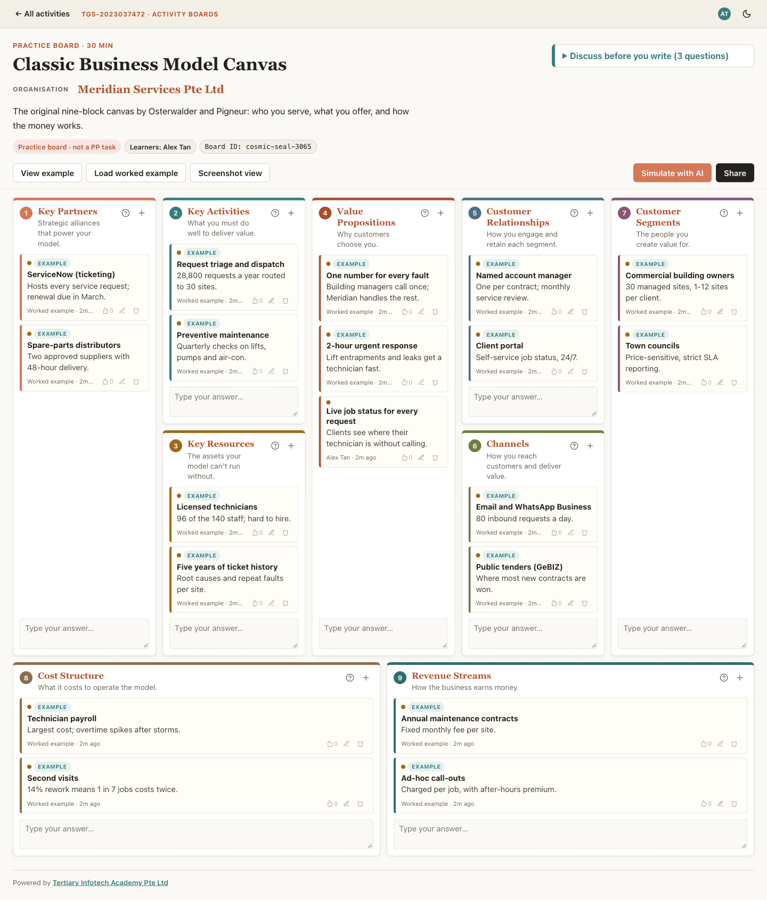

<div align="center">

# Activity Boards: Business Innovation with Agentic AI and AI Agents

[](https://developer.mozilla.org/en-US/docs/Web/HTML)
[](https://developer.mozilla.org/en-US/docs/Web/CSS)
[](https://developer.mozilla.org/en-US/docs/Web/JavaScript)
[](https://firebase.google.com/)
[](https://opensource.org/licenses/MIT)

**Type your answers on a live board, screenshot it, paste it into your Practical Performance.**

[Open the boards](https://alfredang.github.io/bcm/) · [Report a bug](https://github.com/alfredang/bcm/issues)

</div>


## What this is

The online activity tool for the WSQ course **Business Innovation with Agentic AI and AI Agents** (TGS-2023037472, Tertiary Infotech Academy). Each class activity has its own board. Learners open a board with just their name (no login), type their answers into each block as sticky notes, then take a screenshot of the finished board and paste it into their Practical Performance (PP) assessment.

| Activity | Board | LO · K&A | Screenshot goes into | Deep link |
|---|---|---|---|---|
| 1 | Agentic AI Business Canvas | LO1 · K1, K2, A1, A2 | **PP Task 1** | <https://alfredang.github.io/bcm/?activity=opportunity> |
| 2 | AI Action Plan | LO2 · K3, K4, A3, A4 | **PP Task 2** | <https://alfredang.github.io/bcm/?activity=actionplan> |
| 3 | Lead the Change & Run the Company | LO3 · K5, K6, A5, A6 | **PP Task 3** | <https://alfredang.github.io/bcm/?activity=change> |
| – | Classic Business Model Canvas (practice) | – | not a PP task | <https://alfredang.github.io/bcm/?activity=bmc> |

The activity content (block titles, prompts, guiding questions, discussion questions and the worked example) comes from the course build in [`js/templates.js`](js/templates.js). That file is generated; do not edit it by hand.

## How learners use it

1. **Open a board.** Pick the activity, type your name and your organisation (the board title), press *Create board*. Classmates join from the *Share* QR code or Board ID and edit live.
2. **Type your answers.** Every block has a *Type your answer…* box: press Enter to save (Shift+Enter for a new line; the first line becomes the headline). The **+** button opens the full note editor (tag, priority, status). Notes can be voted on, edited and dragged to reorder.
3. **Stuck?** *View example* shows how **Meridian Services Pte Ltd**, a fictional Singapore facilities firm, filled in each block, without writing anything. *Load worked example* copies those notes onto the board, tagged `Example`.
4. **Hand it in.** *Screenshot view* hides the editing tools and adds a header strip with the course, activity, organisation, learner names and date. From there: **Download PNG**, **Download PDF** (one landscape A4 page), or **Print**. Paste the image into your PP.

## Board screenshots

| Activity 1 · Agentic AI Business Canvas | Activity 2 · AI Action Plan |
|---|---|
|  |  |
| **Activity 3 · Lead the Change & Run the Company** | **Classic Business Model Canvas** |
|  |  |

## AI business simulator (optional, bring your own key)

*Simulate with AI* opens a drawer that tests the board against a fictional Singapore business:

| Sample business | Sector |
|---|---|
| Meridian Services Pte Ltd | Facilities maintenance (the course's worked example) |
| Lantern Lane Kopi Pte Ltd | F&B kopi chain |
| Harbourview Family Clinics | GP clinic group |
| Straits Linkage Logistics Pte Ltd | SME freight forwarder |
| Keystone & Lim Chartered Accountants | 40-person accounting firm |

All five are invented; any resemblance to a real company is unintended. Actions:

- **Generate dormant data samples**: simulated emails, tickets and chats the business never analyses, and what each one reveals.
- **Suggest ideas for this block**: three sticky notes you can add in one click (tagged `AI`).
- **Simulate 90 days**: an outcome story and KPI table for the plan on the board, including one thing that goes wrong.
- **Play a stakeholder**: how three affected people react to the change.

The simulator calls the Anthropic Messages API (`claude-sonnet-5-5`) **directly from the learner's browser with the learner's own API key**.

> **Privacy.** The key is stored only in that browser's `localStorage` (`bcm.anthropicKey`) and is sent only to `api.anthropic.com`. It is never written to Firestore, never committed to this repository and never logged. *Clear* removes it. The board's notes are sent to Anthropic only when the learner presses a simulator action.

**No key?** The drawer still works for Meridian Services: each action shows a canned example, clearly labelled *Example output (no API key)*.

## Tech stack

| Area | Choice |
|---|---|
| Pages | Plain HTML, CSS and ES-module JavaScript. No build step. |
| Real-time data | Firebase Cloud Firestore (modular SDK from the gstatic CDN) |
| Sharing | QRCode.js (jsDelivr) |
| Screenshot export | html2canvas and jsPDF (jsDelivr, loaded only when first used); print stylesheet as fallback |
| AI | Anthropic Messages API, called with `fetch` from the browser |
| Hosting | GitHub Pages via GitHub Actions |
| Design | Tertiary Infotech course-site look: ivory `#FAF9F5`, charcoal `#21201C`, terracotta `#D97757`, teal `#3A7D7B`, Cambria headings, Calibri body. Light by default, dark theme on request. |

## Project structure

```
bcm/
├── index.html            # Landing page, board page, simulator drawer, modals
├── css/styles.css        # Design tokens (light + dark), layouts, screenshot + print styles
├── js/
│   ├── templates.js      # GENERATED by the course build: the activities and worked example
│   ├── boards.js         # Activity catalogue + classic BMC + retired activities
│   ├── app.js            # Theme, routing (#/c/<id>, ?activity=, ?join=), toast, modals
│   ├── landing.js        # Activity cards, create / join
│   ├── canvas.js         # Board page: header, blocks, typed answers, presence
│   ├── notes.js          # Sticky notes: live sync, editor, votes, reorder, examples
│   ├── shot.js           # Screenshot view, PNG / PDF / print
│   ├── simulator.js      # Simulator drawer and safe Markdown renderer
│   ├── ai.js             # Anthropic API client and prompts (key stays in localStorage)
│   ├── businesses.js     # Five fictional businesses + offline example outputs
│   ├── keybox.js         # API-key box
│   ├── share.js          # QR code + invite link
│   └── firebase.js       # Firebase config
├── docs/screens/         # Board screenshots
└── screenshot.png        # Landing page screenshot
```

## Data model (Firestore)

```
canvases/{boardId}                    title, org, type, ownerName, learners[], createdAt
canvases/{boardId}/blocks/{blockId}/notes/{noteId}
                                      title, description, category, priority, status,
                                      authorId, authorName, votes, voters[], order,
                                      createdAt, updatedAt
canvases/{boardId}/presence/{participantId}   name, color, lastSeen
```

- `type` is the activity key (`opportunity`, `actionplan`, `change`, `bmc`). Boards made before the course boards have no `type` and open as the classic Business Model Canvas; boards of a retired activity (`companymap`) still open with their notes and a "retired activity" note.
- `category` is free text; `Example` (worked example) and `AI` (simulator suggestion) are styled tags.

Firestore rules are set by the project owner in the Firebase console. The app expects read/write access to `canvases/**`.

## Run locally

```bash
git clone https://github.com/alfredang/bcm.git
cd bcm
python3 -m http.server 8080
```

Open <http://localhost:8080>. ES modules need an HTTP origin; `file://` will not work.

## Deploy

`.github/workflows/deploy-pages.yml` publishes the repository to GitHub Pages on every push to `main`.

## Acknowledgements

- Business Model Canvas by **Alexander Osterwalder and Yves Pigneur** (Strategyzer).
- [Firebase](https://firebase.google.com/), [QRCode.js](https://github.com/davidshimjs/qrcodejs), [html2canvas](https://html2canvas.hertzen.com/), [jsPDF](https://github.com/parallax/jsPDF), [Anthropic API](https://docs.anthropic.com/).

## Developed by

**Tertiary Infotech Academy Pte Ltd**: [tertiarycourses.com.sg](https://www.tertiarycourses.com.sg/)

## License

[MIT](https://opensource.org/licenses/MIT)

---

<div align="center">Powered by <a href="https://www.tertiarycourses.com.sg/">Tertiary Infotech Academy Pte Ltd</a></div>
